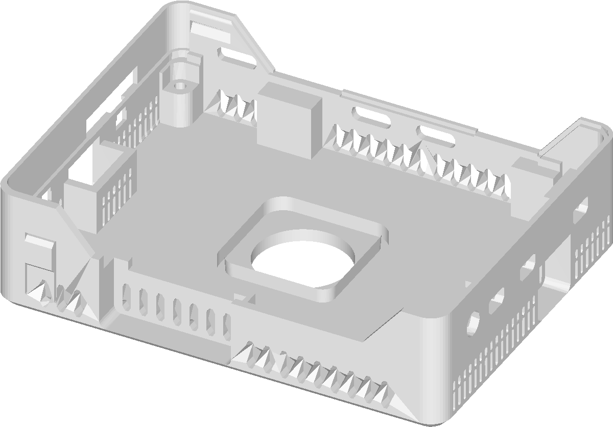
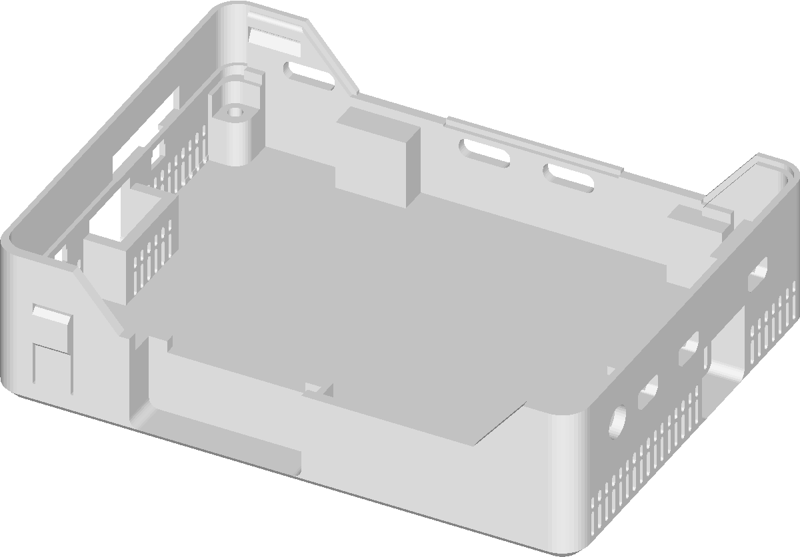

#  Sense Axon Box

An open rework of the **Vicharak Axon 0.3/0.2 enclosure** for the SENSE device.
The original fit is kept exactly — same screw bosses, same rim and lid seat,
same end grilles — and two things are added for the RK3588:

- a **ventilation ring**: 33 slots cut into both long walls, so the tray
  breathes on all four sides instead of only through the two ends;
- a **25 mm fan seat** cut into the tray floor, for the active cooler that
  sits under the board: a 25.7 mm bore through the 3.0 mm floor with a lead-in
  and a Ø22 ledge the fan frame rests on.

Everything is parametric OpenSCAD; the part is a single self-contained file
plus a print-ready STL.

| Before (as shipped by Vicharak) | After |
| --- | --- |
|  |  |

## Features

- **360° venting** — the tray goes from 526 mm² to 1014 mm² of free area, now on
  all four sides: the flow path is floor intake → fan → heatsink → out through
  the wall slots, at the same height as the cooler.
- **Fan seat in the floor** — a 25.7 mm rounded-square bore through the 3.0 mm
  floor, a 0.5 mm lead-in at its mouth and a Ø22 mm bore that leaves a 0.5 mm
  ledge for the fan frame to rest on. Concentric with the RK3588, so the fan
  and heatsink stay aligned with the chip. The seat is **cut, never added**:
  nothing protrudes into the tray, and the export stays clean.
- **Nothing to foul** — the whole seat lives inside the floor's thickness, so
  the heatsink gets ~7.7 mm of room under the board instead of ~5 mm, and no
  part of the print can press on a heatsink that overhangs the fan.
- **Support-free print** — the slots end in ~59° bevels with a 0.8 mm flat cap,
  so the widest unsupported span is 0.8 mm; the fan ring is a vertical wall on
  a flat floor. Nothing to support, nothing to bridge, in the orientation shown.
- **Same fit** — a material map of the exported part differs from the shipped
  case in nothing outside the fan's 36 × 36 mm footprint: the four M2.5 bosses
  (board datum), the rim, the lid seat, the corner posts and both end grilles
  are untouched.
- **Clean mesh** — the converted STEP mesh was welded, de-junked and
  re-triangulated: 48 852 loose vertices → 2 784, two floating zero-volume
  patches removed, 63 non-manifold edges repaired, 16 284 → 6 000 facets
  (mean deviation 0.001 mm, 99th percentile 0.025 mm, max 0.088 mm, and the
  1 mm end grilles keep 98 % of their open area).
- **Parametric** — slot width, pitch, band, bevels, fan size, clearance, seat
  height and fan centre are all named constants at the top of the file.

## What changed

| | original | this repo |
| --- | --- | --- |
| long walls | solid | 33 slots, 2.0 × 6.9 mm, 4.0 mm pitch, band z = −14.5 … −7.6 |
| free vent area | 526 mm² (ends only) | **1014 mm²** (all four sides) |
| tray floor | solid 3.0 mm plate | **25.7 mm fan bore + Ø22 ledge**, flush, at the RK3588 |
| mesh | 16 284 facets, 48 852 loose vertices, 2 junk patches, 63 non-manifold edges | 6 000 facets, welded, junk-free, manifold export |

The fan pocket is placed from Vicharak's own data rather than from a photo: the
floor bosses sit on a 95.5 × 69.0 mm rectangle centred on the tray, the Axon
PCB is 101.50 × 75.00 mm with its M2.5 holes 3.0 mm in from every edge (so the
board is centred on that rectangle), and in `AXON_3D_file_V0.3.step` the RK3588
body is 23.00 × 23.00 × 1.89 mm with its centre 0.75 / 0.50 mm off the PCB
centre, on the board's under-face. Hence `fan_center = [-0.75, -0.50]`.

## Print settings

| | |
| --- | --- |
| orientation | floor on the bed, as drawn |
| nozzle / layer | 0.4 mm / 0.2 mm |
| perimeters | 3–4, so the 1.8 mm vent webs come out solid |
| supports | none — nothing overhangs more than ~30° except 0.8 mm slot caps |
| material | PETG / ABS / ASA recommended for the tray that carries the heatsink; PLA is fine for the lid |

Vertical budget, measured from the case: the board's under-face sits at
z ≈ −4 (the +Y wall's cable opening tops out there) and the RK3588 hangs 1.9 mm
below it. The fan sits in the floor, so the heatsink gets the space from the
chip's underside down to the fan's top face: **≈ 7.7 mm** with a 3.5 mm fan.

Hardware: 25 × 25 × 3.5 mm fan, 4 × M2.5 × 12 mm self-tapping screws for the
board (as in Vicharak's assembly guide).

If you would rather have the seat raised above the floor, set
`fan_seat_raised = true`: that gives the 3.5 mm ring from the first revision,
at the cost of ~3 mm of heatsink room and of 272 buried duplicate facets that
the union leaves in the export.

## Files

| path | what it is |
| --- | --- |
| `Axon0p3_0p2_Case_Bottom Part_121224.scad` | the part: mesh, VENT SECTION, FAN SECTION — open in OpenSCAD, F5/F6 and export |
| `Axon0p3_0p2_Case_Bottom Part_121224.scad.stl` | print-ready binary STL exported from the above |
| `sense-Top/` | the matching top shell with the SENSE wordmark (STEP + STL + renders) |
| `senseBottom/` | the original Vicharak bottom-shell STEP/STL, for reference |
| `vent_preview/` | measurement maps, renders and check sheets (vents, mesh, fan pocket) |
| `axon-dimensions.png` | the vendor's dimension drawing of the Axon |
| `assets/` | images used by this README |

Sections in the `.scad`: `object1` (the cleaned mesh), `VENT SECTION`
(parameters, slot profile, rows), `FAN SECTION` (fan seat, cutout, placement).
Set `fan_seat = false` for the intake cutout on its own, and mirror `fan_center`
to `[+0.75, +0.50]` if the board goes into the tray the other way round.

## References

- Vicharak Axon documentation — <https://docs.vicharak.in/vicharak_sbcs/axon/axon-home/>
- Axon overview, dimensions and features — <https://docs.vicharak.in/vicharak_sbcs/axon/axon-overview/>
- Axon downloads: pinouts, board STEP, official case files — <https://docs.vicharak.in/vicharak_sbcs/axon/axon-downloads/>
- Axon board STEP `AXON_3D_file_V0.3.step` — <https://docs.vicharak.in/_static/files/AXON_3D_file_V0.3.step.7z>
- Official case `Axon0p3_0p2_Case_121224.zip` — <https://docs.vicharak.in/_static/files/Axon0p3_0p2_Case_121224.zip>
- OpenSCAD — <https://openscad.org>
- Mesh repair and re-triangulation done with [PyMeshLab](https://github.com/cnr-isti-vclab/PyMeshLab) (Manifold backend for the boolean)

## License and attribution

Unofficial project. The enclosure geometry is derived from Vicharak's
`Axon0p3_0p2_Case_121224` files, which remain © Vicharak Computers PVT LTD;
"Vicharak", "Axon" and "Rockchip" are trademarks of their respective owners and
are used here only to describe what this case fits. The modifications in this
repository are © Vishal Hirawat.

---

